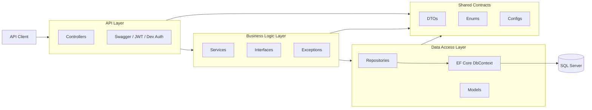

# Apartment Booking

A backend apartment booking system built with ASP.NET Core 8 and a layered architecture.

## Architecture Overview

## Projects

| Project     | Responsibility                                                                                                                      |
| ----------- | ----------------------------------------------------------------------------------------------------------------------------------- |
| `API`       | ASP.NET Core entry point, HTTP controllers, dependency injection, Swagger, JWT authentication, and development middleware.          |
| `BLL`       | Application use cases, business rules, validation, authentication logic, token creation, service interfaces, and domain exceptions. |
| `DAL`       | EF Core database context, entity models, repository implementations, and SQL Server persistence.                                    |
| `Contracts` | Shared DTOs, request and response models, pagination types, configuration classes, and enums.                                       |
